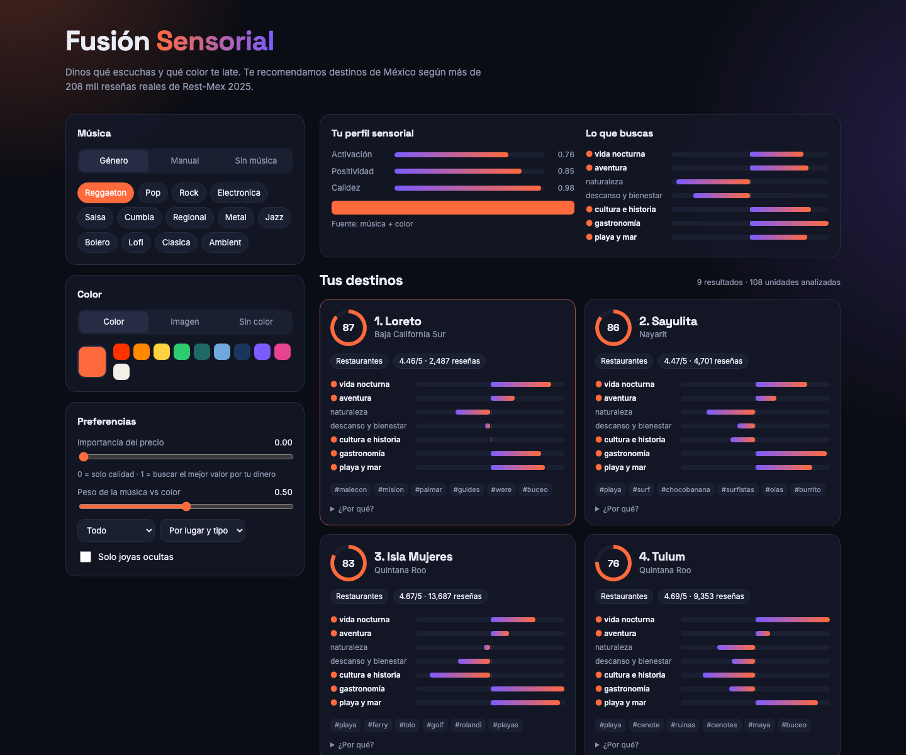
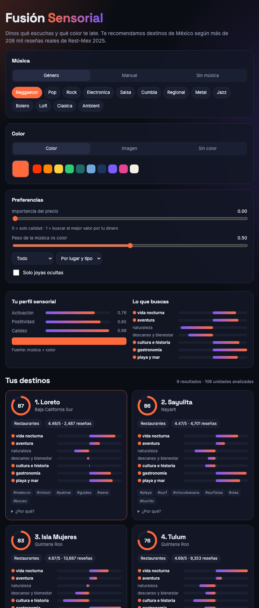

# Fusión Sensorial + Índice de Valor (PySpark)

Recomendador turístico que **no pregunta a dónde quieres ir**: interpreta lo que escuchas (música) y
el color que te gusta, y lo compara con perfiles de 108 unidades (destino, tipo) calculados con
PySpark a partir de 208,051 reseñas reales de Rest-Mex 2025. Un control de presupuesto
favorece el valor percibido y detecta "joyas ocultas".

## Vista previa

| Escritorio | Vista adaptable |
|:---:|:---:|
|  |  |

El panel combina música, color y preferencias de precio para explicar qué destinos encajan mejor con el perfil sensorial generado.

Detalle técnico, decisiones y limitaciones: [`docs/RESUMEN_PROYECTO.txt`](docs/RESUMEN_PROYECTO.txt).

## Estructura
```
src/
  build_profiles.py   Big Data (PySpark): reseñas -> data/processed/profiles.json
  lexicon.py          léxico por dimensión + matriz M sensorial -> turística
  sensory.py          música (preset/manual/CSV) + color (hex/imagen) -> perfil (A, P, W)
  recommender.py      afinidad coseno + calidad/valor -> top-N con explicación
  main.py             CLI
  evaluate.py         coherencia, presupuesto, cobertura, presets, fiabilidad por mitades
  demo.py             demos de la presentación con narrativa
  web.py              servidor del front (solo librería estándar)
web/index.html        front
data/presets.json     presets de género (editables)
data/processed/       profiles.json ya calculado (no necesitas Spark para usar el front)
notebooks/            versión Colab (solo llama a src/)
Dockerfile, docker-compose.yml
```

## Con Docker (recomendado: funciona igual en cualquier PC)
Solo necesitas [Docker Desktop](https://www.docker.com/products/docker-desktop/). Java, Spark y Python vienen en la imagen.
```bash
docker compose up --build                  # front en http://localhost:8000  (Ctrl+C para salir)

# Recalcular perfiles con Spark: primero copia el CSV a data/raw/
docker compose run --rm app python -m src.build_profiles
docker compose run --rm app python -m src.evaluate --presets --split-half
docker compose run --rm app python -m src.demo                       # demos con narrativa
docker compose run --rm app python -m src.main --preset salsa --color "#FF8800"
```
`data/` se monta como volumen: el CSV se lee de tu disco y los perfiles recalculados se quedan ahí.

## Sin Docker (sin Spark)
```bash
pip install Pillow            # solo para recomendar a partir de imágenes
python -m src.web             # front en http://localhost:8000
python -m src.main --preset reggaeton --color "#FF8800" --presupuesto 0.5
python -m src.main --color "#6FA8DC" --presupuesto 0.8 --solo-joyas --vista destinos
python -m src.main --listar-presets
python -m src.evaluate --presets
python -m src.demo
```

## Clasificar una canción con GTZAN

La nueva entrada “Subir canción” usa un MLP pequeño entrenado con el dataset GTZAN.
El modelo no se incluye en Git: se puede entrenar localmente o en Docker antes de
subir archivos de audio.

### Preparar el dataset

Descarga GTZAN en `data/gtzan/genres_original/`. La estructura debe quedar así:

```text
data/gtzan/genres_original/
  blues/
  classical/
  country/
  disco/
  hiphop/
  jazz/
  metal/
  pop/
  reggae/
  rock/
```

### Entrenar

```bash
docker compose run --rm app python -m src.train_music_classifier
```

Sin Docker:

```bash
pip install -r requirements.txt
python -m src.train_music_classifier
```

El resultado se guarda en `models/gtzan_mlp.joblib` y debe reportar la precisión
obtenida con el 20 % reservado para prueba.

Después inicia el servidor y elige **Subir canción**:

```bash
docker compose up --build
# http://localhost:8000
```

También puedes probar una canción desde la CLI:

```bash
python -m src.main --cancion ruta/cancion.mp3 --titulo-cancion "Sembrando flores Los Cojolines" --vista destinos
```

El MLP clasifica géneros GTZAN y los convierte a los presets actuales. La canción
`Sembrando Flores` tiene una asociación demostrativa a `regional`, documentada en
`src/music_classifier.py`, sin reentrenar ni sobreajustar la red con esa canción.

## Recalcular perfiles (PySpark)
Requiere Python 3.10+ y Java 17+.
```bash
python -m venv .venv && source .venv/bin/activate
pip install -r requirements.txt
cp /ruta/Rest-Mex_2025_train_clean.csv data/raw/      # o: export RESTMEX_CSV=/ruta/al.csv
python -m src.build_profiles                           # "Reseñas cargadas: 208,051" y 108 unidades
python -m src.evaluate --presets --split-half
```
Ejecuta siempre desde la raíz del proyecto.
